# Dependencies: Photo Vault

Register of dependencies at issue, component, role, and external level, with
date concerns and five maps. Owner: Simon (TPM). Maintained with the
`dependency-map` skill and `scripts/check_deps.py`.

- **Label.** Proposed: a recorded source states it. Inferred: Claude's
  reasoning, owner missing until Simon confirms one.
- **Direction.** Dependent needs Blocker or Provider. Issue rows mirror GitHub
  Blocked by links.
- **Dates.** Issue start and target dates come from Project 1. Need-by and
  Committed come from Project 1 for non-code issues, or from this table for
  rows without an issue.
- **Changes.** Rows, links, and dates change only after Simon approves.
  `check_deps.py --write` updates the Concerns column and the generated
  section below.
- **Legal.** None identified (personal, non-commercial project; checked
  2026-10-22).

## Register

| ID | Dependent | Blocker or Provider | Level | Type | Label | Source | Need-by | Committed | Owner | Status | Concerns |
|---|---|---|---|---|---|---|---|---|---|---|---|
| DEP-001 | #2 Review intent PR | #1 intent.md | issue | Code | Proposed | #2 body "Closes #1"; date plan 2026-10-21 |  |  | board | Open | C13 |
| DEP-002 | #5 requirements.md | #2 Review intent PR | issue | Code | Proposed | Date plan 2026-10-21 |  |  | board | Open |  |
| DEP-003 | #6 design.md | #5 requirements.md | issue | Code | Proposed | Date plan 2026-10-21 |  |  | board | Open | C14 |
| DEP-004 | #6 design.md | #8 HEIC test run (R1) | external | Tooling | Proposed | Date plan 2026-10-21; raid.md R1 | 2026-11-04 |  | board | Open | C15 |
| DEP-005 | #7 Threat list | #6 design.md | issue | Code | Proposed | Date plan 2026-10-21 |  |  | board | Open | C16 |
| DEP-006 | #9 Design review | #7 Threat list | issue | Code | Proposed | Date plan 2026-10-21 |  |  | board | Open | C17 |
| DEP-007 | #13 CLAUDE.md and skill | #10 Skeleton | issue | Code | Proposed | Date plan 2026-10-21 (M3 order change) |  |  | board | Open | C21 |
| DEP-008 | #11 Login | #10 Skeleton | issue | Code | Proposed | Date plan 2026-10-21 |  |  | board | Open |  |
| DEP-009 | #11 Login | #13 CLAUDE.md and skill | issue | Code | Proposed | Date plan 2026-10-21 |  |  | board | Open | C19 |
| DEP-010 | #12 Upload and gallery | #11 Login | issue | Code | Proposed | Date plan 2026-10-21 |  |  | board | Open | C20 |
| DEP-011 | #14 Worktrees | #12 Upload and gallery | issue | Code | Proposed | Date plan 2026-10-21 |  |  | board | Open | C10 |
| DEP-012 | #17 Hook | #14 Worktrees | issue | Code | Proposed | Date plan 2026-10-21 ("M3 tests already exist") |  |  | board | Open | C23 |
| DEP-013 | #16 pytest suite | #17 Hook | issue | Code | Proposed | Date plan 2026-10-21 |  |  | board | Open | C22 |
| DEP-014 | #19 Evals | #18 Weekly-status skill | issue | Code | Proposed | Date plan 2026-10-21 |  |  | board | Open | C24 |
| DEP-015 | #20 evals.yml | #19 Evals | issue | Code | Proposed | Date plan 2026-10-21 |  |  | board | Open | C25 |
| DEP-016 | #23 Claude review | #22 CI | issue | Code | Proposed | Date plan 2026-10-21 |  |  | board | Open | C26 |
| DEP-017 | #26 deploy.yml | #25 Dockerfile | issue | Code | Proposed | Date plan 2026-10-21 |  |  | board | Open | C27 |
| DEP-018 | #27 Launch checklist | #26 deploy.yml | issue | Code | Proposed | Date plan 2026-10-21; C1 split approved 2026-10-22 |  |  | board | Open | C11 |
| DEP-019 | #29 Metrics scripts | #28 Middleware | issue | Code | Proposed | Date plan 2026-10-21 |  |  | board | Open | C28 |
| DEP-020 | #30 Metrics review | #29 Metrics scripts | issue | Code | Proposed | Date plan 2026-10-21 |  |  | board | Open | C29 |
| DEP-021 | #31 Retro | #30 Metrics review | issue | Code | Proposed | Date plan 2026-10-21 |  |  | board | Open | C12 |
| DEP-022 | #8 HEIC test run | #3 Python 3.12 (D2) | external | Tooling | Inferred | #8 needs python:3.12; #3 installs it | 2026-11-03 |  | board | Open |  |
| DEP-023 | #10 Skeleton | #3 Python 3.12 (D2) | external | Tooling | Proposed | raid.md D2 "Blocks M3" | 2026-11-09 |  | board | Open |  |
| DEP-024 | #10 Skeleton | #9 Design review | issue | Code | Inferred | Build starts after the design merge |  |  | board | Open | C18 |
| DEP-025 | #19 Evals | #13 CLAUDE.md and skill | issue | Code | Inferred | The add-route eval needs the skill |  |  | board | Open |  |
| DEP-026 | #22 CI | #16 pytest suite | issue | Code | Inferred | ci.yml runs the pytest suite |  |  | board | Open |  |
| DEP-027 | #23 Claude review | #20 evals.yml and key | issue | Code | Inferred | Claude review needs the ANTHROPIC_API_KEY secret from #20 |  |  | board | Open |  |
| DEP-028 | #25 Dockerfile | #8 HEIC test run | issue | Code | Inferred | The Dockerfile relies on the pillow-heif result |  |  | board | Open |  |
| DEP-029 | #26 deploy.yml | #22 CI | issue | Code | Inferred | Deploy runs after CI checks |  |  | board | Open |  |
| DEP-030 | #28 Middleware | #12 Upload and gallery | issue | Code | Inferred | The middleware wraps app routes |  |  | board | Open |  |
| DEP-031 | #18 Weekly-status skill | #36 dependency-map skill | issue | Code | Proposed | Dependency-map proposal approved 2026-10-22 (status feed) |  |  | board | Open |  |
| DEP-032 | #19 Evals | #36 dependency-map skill | issue | Code | Proposed | Dependency-map proposal approved 2026-10-22 (eval cases) |  |  | board | Open |  |
| DEP-033 | #22 CI | #36 dependency-map skill | issue | Code | Proposed | Dependency-map proposal approved 2026-10-22 (deps-check.yml) |  |  | board | Open |  |
| DEP-034 | #25 Dockerfile | Docker Desktop install (D3, done in #25) | external | Tooling | Proposed | raid.md D3 | 2026-12-14 | in #25 | Simon | Open |  |
| DEP-035 | #20 evals.yml | #38 API key and spending limit (D4) | external | Cost approval | Proposed | raid.md D4 | 2026-12-04 |  | board | Open | C5 |
| DEP-036 | #23 Claude review | #38 API key and spending limit (D4) | external | Cost approval | Proposed | raid.md D4 | 2026-12-09 |  | board | Open | C5 |
| DEP-037 | #12 Upload and gallery | #39 pillow-heif licenses (N1) | external | Licensing | Inferred | First pass 2026-10-22 | 2026-11-16 |  | owner missing | Open | C1 C6 |
| DEP-038 | #26 deploy.yml | #39 pillow-heif licenses (N1) | external | Licensing | Inferred | First pass 2026-10-22 (public GHCR image) | 2026-12-16 |  | owner missing | Open | C1 C6 |
| DEP-039 | #6 design.md | #40 EXIF and GPS metadata (N2) | external | Privacy | Inferred | First pass 2026-10-22 | 2026-11-04 |  | owner missing | Open | C2 C7 |
| DEP-040 | #22 CI | #41 read:project token (N3) | external | Vendor | Inferred | Dependency-map design 2026-10-22 | 2026-12-07 |  | owner missing | Open | C3 C8 |
| DEP-041 | #25 Dockerfile | #42 Docker Desktop license (N4) | external | Vendor | Inferred | First pass 2026-10-22 | 2026-12-14 |  | owner missing | Open | C4 C9 |
| DEP-042 | app/main.py | app/db.py | component | Component | Proposed | #10 body |  |  |  | Planned |  |
| DEP-043 | app/main.py | templates/ | component | Component | Proposed | #10 body |  |  |  | Planned |  |
| DEP-044 | app/main.py | app/auth.py | component | Component | Proposed | #11 body "Every photo route requires a session" |  |  |  | Planned |  |
| DEP-045 | app/main.py | app/photos.py | component | Component | Proposed | #12 body |  |  |  | Planned |  |
| DEP-046 | app/photos.py | app/auth.py | component | Component | Proposed | #11 body |  |  |  | Planned |  |
| DEP-047 | app/photos.py | app/db.py | component | Component | Proposed | #12 body "record in SQLite" |  |  |  | Planned |  |
| DEP-048 | app/photos.py | storage/ (gitignored) | component | Component | Proposed | #12 body |  |  |  | Planned |  |
| DEP-049 | app/photos.py | pillow-heif (#39) | component | Licensing | Proposed | #8, #12 bodies |  |  |  | Planned | C1 C6 |
| DEP-050 | tests/ | app/main.py | component | Component | Proposed | #16 body |  |  |  | Planned |  |
| DEP-051 | .claude hook: ruff, pytest | tests/ | component | Component | Proposed | #17 body |  |  |  | Planned |  |
| DEP-052 | ci.yml | tests/ | component | Component | Proposed | #22 body |  |  |  | Planned |  |
| DEP-053 | evals.yml | evals/ | component | Component | Proposed | #20 body |  |  |  | Planned |  |
| DEP-054 | evals.yml | ANTHROPIC_API_KEY (#38) | component | Cost approval | Proposed | #20 body |  |  |  | Planned | C5 |
| DEP-055 | Claude review workflow | ANTHROPIC_API_KEY (#38) | component | Cost approval | Inferred | #23 uses the key from #20 |  |  |  | Planned | C5 |
| DEP-056 | deps-check.yml | scripts/check_deps.py | component | Component | Proposed | #22 body |  |  |  | Planned |  |
| DEP-057 | deps-check.yml | read:project token (#41) | component | Vendor | Proposed | #22 body |  |  |  | Planned | C3 C8 |
| DEP-058 | scripts/check_deps.py | docs/program/dependencies.md | component | Component | Proposed | #36 body |  |  |  | Built |  |
| DEP-059 | deploy.yml | Dockerfile | component | Component | Proposed | #26 body |  |  |  | Planned |  |
| DEP-060 | Dockerfile | pillow-heif (#39) | component | Licensing | Proposed | #25 body |  |  |  | Planned | C1 C6 |
| DEP-061 | GHCR image (public) | deploy.yml | component | Component | Proposed | #26 body |  |  |  | Planned |  |
| DEP-062 | staging, production Environments | GHCR image (public) | component | Component | Proposed | #26 body |  |  |  | Planned |  |
| DEP-063 | timing middleware | app/main.py | component | Component | Inferred | #28 wraps app routes |  |  |  | Planned |  |
| DEP-064 | metrics.jsonl | timing middleware | component | Component | Proposed | #28 body |  |  |  | Planned |  |
| DEP-065 | scripts/check_metrics.py | metrics.jsonl | component | Component | Proposed | #29 body |  |  |  | Planned |  |
| DEP-066 | docs/intent/002 | scripts/check_metrics.py | component | Component | Proposed | #29 body |  |  |  | Planned |  |

<!-- BEGIN GENERATED: scripts/check_deps.py --write -->

Generated 2026-10-22 from the register and Project 1.

## Concerns

High 0 · Medium 12 · Low 17

| ID | Severity | Check | Issues | Dates compared | Suggested action | Verify | Register rows |
|---|---|---|---|---|---|---|---|
| C1 | Medium | missing owner | [#39](https://github.com/simonshenn/photo-vault/issues/39) | #39 Licensing: owner missing | Confirm an owner for #39 | TPM | DEP-037, DEP-038, DEP-049, DEP-060 |
| C2 | Medium | missing owner | [#40](https://github.com/simonshenn/photo-vault/issues/40) | #40 Privacy: owner missing | Confirm an owner for #40 | TPM | DEP-039 |
| C3 | Medium | missing owner | [#41](https://github.com/simonshenn/photo-vault/issues/41) | #41 Vendor: owner missing | Confirm an owner for #41 | TPM | DEP-040, DEP-057 |
| C4 | Medium | missing owner | [#42](https://github.com/simonshenn/photo-vault/issues/42) | #42 Vendor: owner missing | Confirm an owner for #42 | TPM | DEP-041 |
| C5 | Medium | need-by gap | [#38](https://github.com/simonshenn/photo-vault/issues/38) | #38 Need-by 2026-12-04, Committed missing | Set a Committed date on #38 on or before 2026-12-04 | TPM | DEP-035, DEP-036, DEP-054, DEP-055 |
| C6 | Medium | need-by gap | [#39](https://github.com/simonshenn/photo-vault/issues/39) | #39 Need-by 2026-11-16, Committed missing | Set a Committed date on #39 on or before 2026-11-16 | owner missing | DEP-037, DEP-038, DEP-049, DEP-060 |
| C7 | Medium | need-by gap | [#40](https://github.com/simonshenn/photo-vault/issues/40) | #40 Need-by 2026-11-04, Committed missing | Set a Committed date on #40 on or before 2026-11-04 | owner missing | DEP-039 |
| C8 | Medium | need-by gap | [#41](https://github.com/simonshenn/photo-vault/issues/41) | #41 Need-by 2026-12-07, Committed missing | Set a Committed date on #41 on or before 2026-12-07 | owner missing | DEP-040, DEP-057 |
| C9 | Medium | need-by gap | [#42](https://github.com/simonshenn/photo-vault/issues/42) | #42 Need-by 2026-12-14, Committed missing | Set a Committed date on #42 on or before 2026-12-14 | owner missing | DEP-041 |
| C10 | Medium | same-day handoff | [#14](https://github.com/simonshenn/photo-vault/issues/14), [#12](https://github.com/simonshenn/photo-vault/issues/12) | #12 target 2026-11-18 = #14 start 2026-11-18 (Proposed) | Accept if the handoff happens in order that day, or move #14 start one working day | Engineer | DEP-011 |
| C11 | Medium | same-day handoff | [#27](https://github.com/simonshenn/photo-vault/issues/27), [#26](https://github.com/simonshenn/photo-vault/issues/26) | #26 target 2026-12-17 = #27 start 2026-12-17 (Proposed) | Accept if the handoff happens in order that day, or move #27 start one working day | SRE, TPM | DEP-018 |
| C12 | Medium | same-day handoff | [#31](https://github.com/simonshenn/photo-vault/issues/31), [#30](https://github.com/simonshenn/photo-vault/issues/30) | #30 target 2027-01-07 = #31 start 2027-01-07 (Proposed) | Accept if the handoff happens in order that day, or move #31 start one working day | Product Manager, TPM | DEP-021 |
| C13 | Low | zero slack | [#2](https://github.com/simonshenn/photo-vault/issues/2), [#1](https://github.com/simonshenn/photo-vault/issues/1) | #1 target 2026-10-28, #2 start 2026-10-29 (Proposed) | Accept as planned and watch in the weekly status | Product Manager | DEP-001 |
| C14 | Low | zero slack | [#6](https://github.com/simonshenn/photo-vault/issues/6), [#5](https://github.com/simonshenn/photo-vault/issues/5) | #5 target 2026-11-03, #6 start 2026-11-04 (Proposed) | Accept as planned and watch in the weekly status | Tech Lead | DEP-003 |
| C15 | Low | zero slack | [#6](https://github.com/simonshenn/photo-vault/issues/6), [#8](https://github.com/simonshenn/photo-vault/issues/8) | #8 target 2026-11-03, #6 start 2026-11-04 (Proposed) | Accept as planned and watch in the weekly status | Engineer, Tech Lead | DEP-004 |
| C16 | Low | zero slack | [#7](https://github.com/simonshenn/photo-vault/issues/7), [#6](https://github.com/simonshenn/photo-vault/issues/6) | #6 target 2026-11-04, #7 start 2026-11-05 (Proposed) | Accept as planned and watch in the weekly status | Tech Lead, AppSec | DEP-005 |
| C17 | Low | zero slack | [#9](https://github.com/simonshenn/photo-vault/issues/9), [#7](https://github.com/simonshenn/photo-vault/issues/7) | #7 target 2026-11-05, #9 start 2026-11-06 (Proposed) | Accept as planned and watch in the weekly status | AppSec, TPM | DEP-006 |
| C18 | Low | zero slack | [#10](https://github.com/simonshenn/photo-vault/issues/10), [#9](https://github.com/simonshenn/photo-vault/issues/9) | #9 target 2026-11-06, #10 start 2026-11-09 (Inferred) | Accept as planned and watch in the weekly status | TPM, Engineer | DEP-024 |
| C19 | Low | zero slack | [#11](https://github.com/simonshenn/photo-vault/issues/11), [#13](https://github.com/simonshenn/photo-vault/issues/13) | #13 target 2026-11-11, #11 start 2026-11-12 (Proposed) | Accept as planned and watch in the weekly status | Tech Lead, Engineer | DEP-009 |
| C20 | Low | zero slack | [#12](https://github.com/simonshenn/photo-vault/issues/12), [#11](https://github.com/simonshenn/photo-vault/issues/11) | #11 target 2026-11-13, #12 start 2026-11-16 (Proposed) | Accept as planned and watch in the weekly status | Engineer | DEP-010 |
| C21 | Low | zero slack | [#13](https://github.com/simonshenn/photo-vault/issues/13), [#10](https://github.com/simonshenn/photo-vault/issues/10) | #10 target 2026-11-10, #13 start 2026-11-11 (Proposed) | Accept as planned and watch in the weekly status | Engineer, Tech Lead | DEP-007 |
| C22 | Low | zero slack | [#16](https://github.com/simonshenn/photo-vault/issues/16), [#17](https://github.com/simonshenn/photo-vault/issues/17) | #17 target 2026-11-23, #16 start 2026-11-24 (Proposed) | Accept as planned and watch in the weekly status | QA engineer | DEP-013 |
| C23 | Low | zero slack | [#17](https://github.com/simonshenn/photo-vault/issues/17), [#14](https://github.com/simonshenn/photo-vault/issues/14) | #14 target 2026-11-20, #17 start 2026-11-23 (Proposed) | Accept as planned and watch in the weekly status | Engineer, QA engineer | DEP-012 |
| C24 | Low | zero slack | [#19](https://github.com/simonshenn/photo-vault/issues/19), [#18](https://github.com/simonshenn/photo-vault/issues/18) | #18 target 2026-11-30, #19 start 2026-12-01 (Proposed) | Accept as planned and watch in the weekly status | TPM, Platform engineer | DEP-014 |
| C25 | Low | zero slack | [#20](https://github.com/simonshenn/photo-vault/issues/20), [#19](https://github.com/simonshenn/photo-vault/issues/19) | #19 target 2026-12-03, #20 start 2026-12-04 (Proposed) | Accept as planned and watch in the weekly status | Platform engineer | DEP-015 |
| C26 | Low | zero slack | [#23](https://github.com/simonshenn/photo-vault/issues/23), [#22](https://github.com/simonshenn/photo-vault/issues/22) | #22 target 2026-12-08, #23 start 2026-12-09 (Proposed) | Accept as planned and watch in the weekly status | Platform engineer, Reviewer | DEP-016 |
| C27 | Low | zero slack | [#26](https://github.com/simonshenn/photo-vault/issues/26), [#25](https://github.com/simonshenn/photo-vault/issues/25) | #25 target 2026-12-15, #26 start 2026-12-16 (Proposed) | Accept as planned and watch in the weekly status | SRE | DEP-017 |
| C28 | Low | zero slack | [#29](https://github.com/simonshenn/photo-vault/issues/29), [#28](https://github.com/simonshenn/photo-vault/issues/28) | #28 target 2027-01-04, #29 start 2027-01-05 (Proposed) | Accept as planned and watch in the weekly status | SRE | DEP-019 |
| C29 | Low | zero slack | [#30](https://github.com/simonshenn/photo-vault/issues/30), [#29](https://github.com/simonshenn/photo-vault/issues/29) | #29 target 2027-01-06, #30 start 2027-01-07 (Proposed) | Accept as planned and watch in the weekly status | SRE, Product Manager | DEP-020 |

## Maps

Arrows point from the blocker to the dependent. Dashed: Inferred. Red: High concern. Amber: Medium concern. Green: done. Dates: start→target.

### Level 1: Program

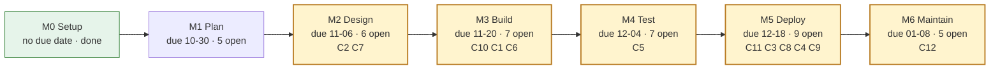

### Level 2: Issues

#### M0 Setup

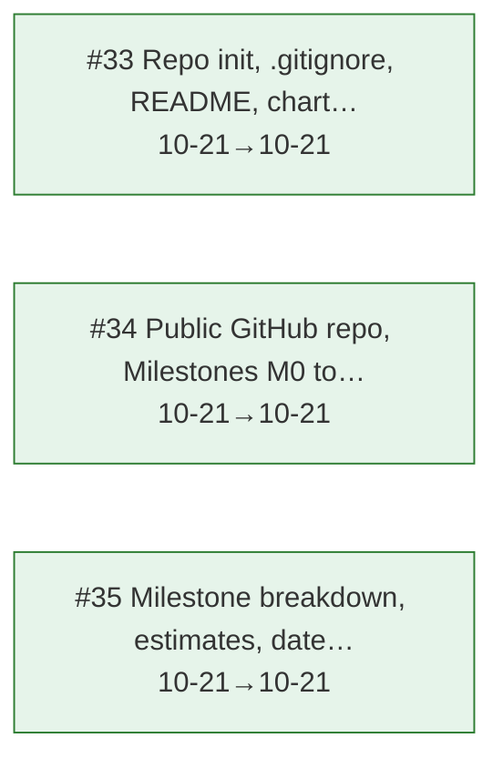

#### M1 Plan

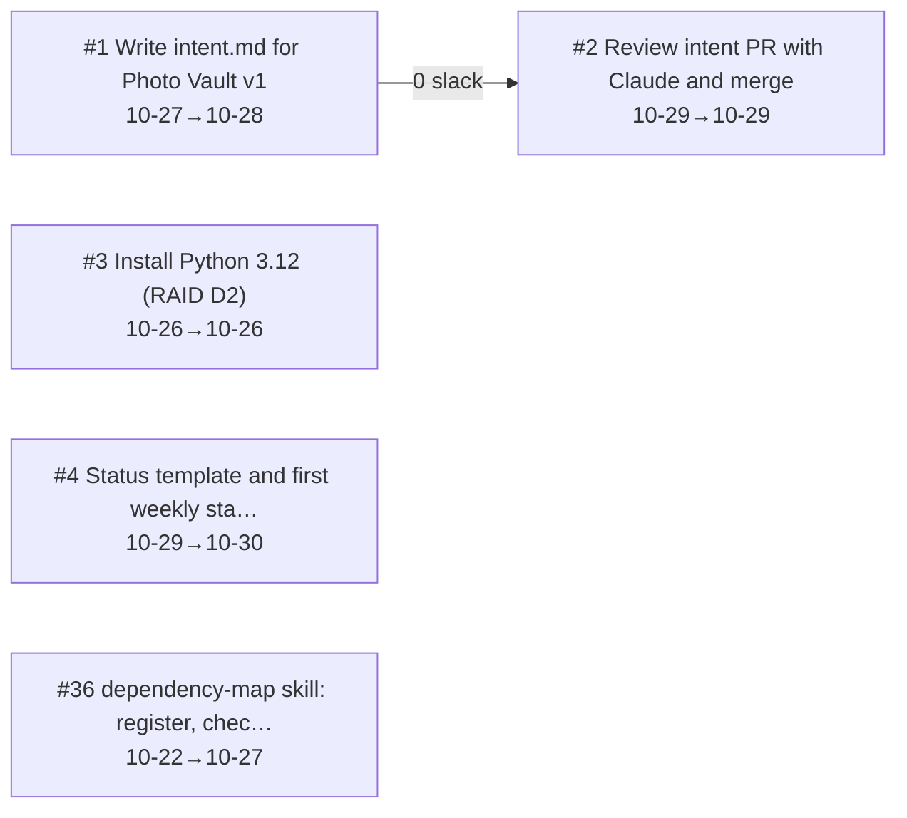

#### M2 Design

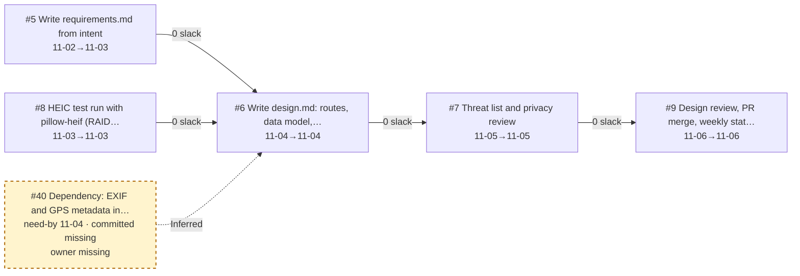

#### M3 Build

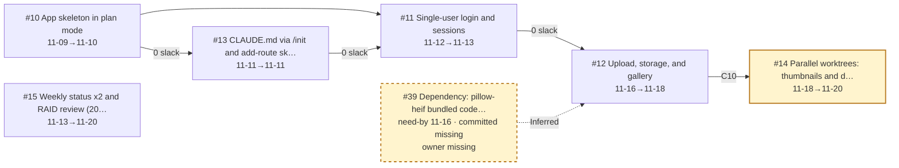

#### M4 Test

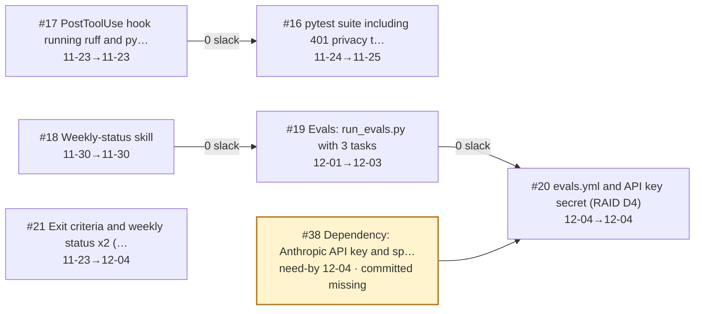

#### M5 Deploy

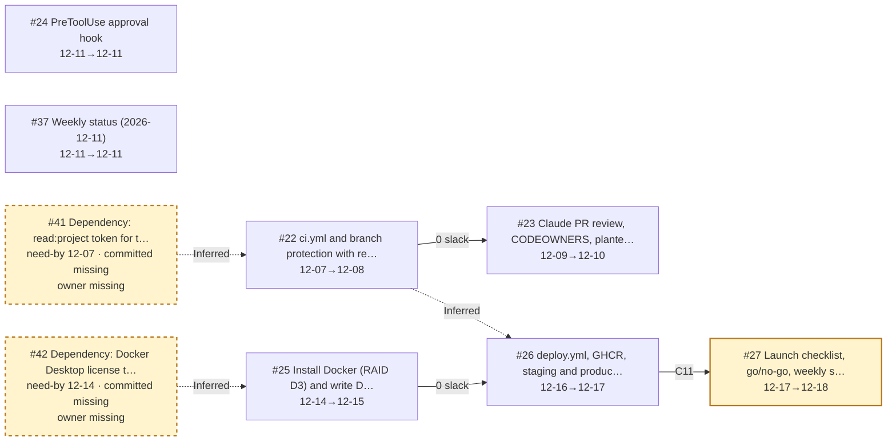

#### M6 Maintain

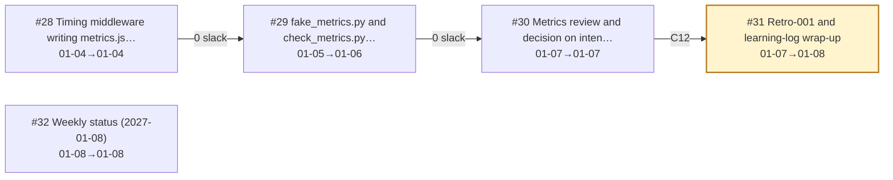

#### Across milestones

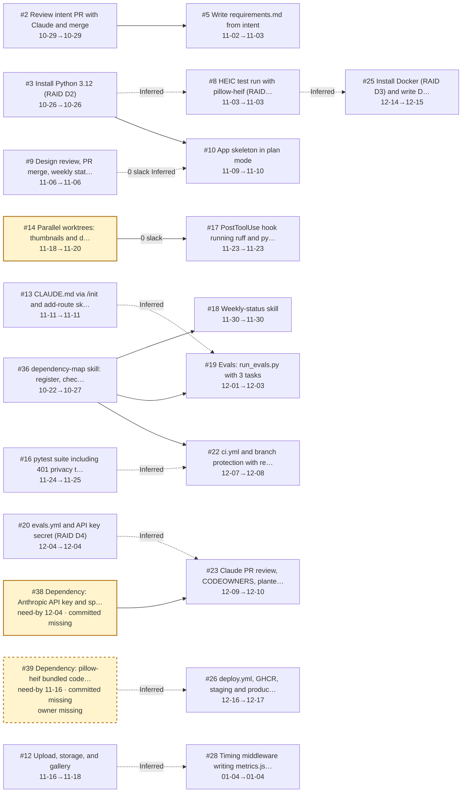

### Level 3: Components

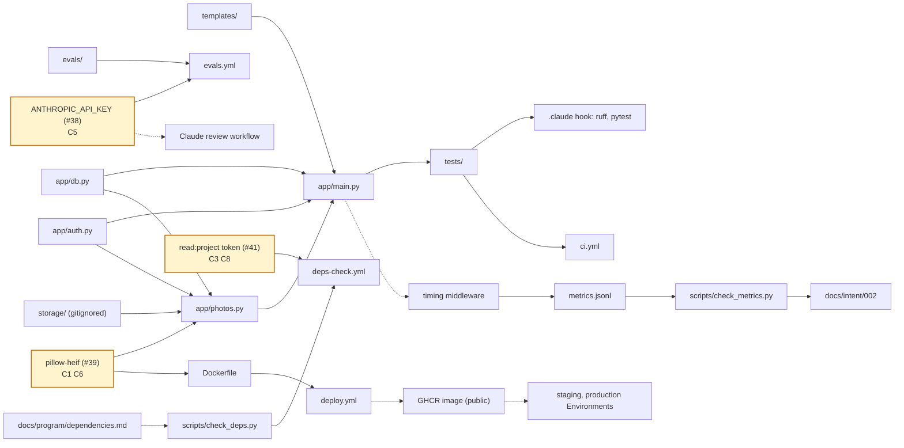

### Level 4: Role handoffs

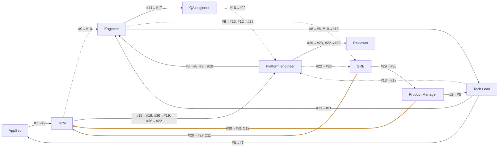

### Level 5: External and non-code

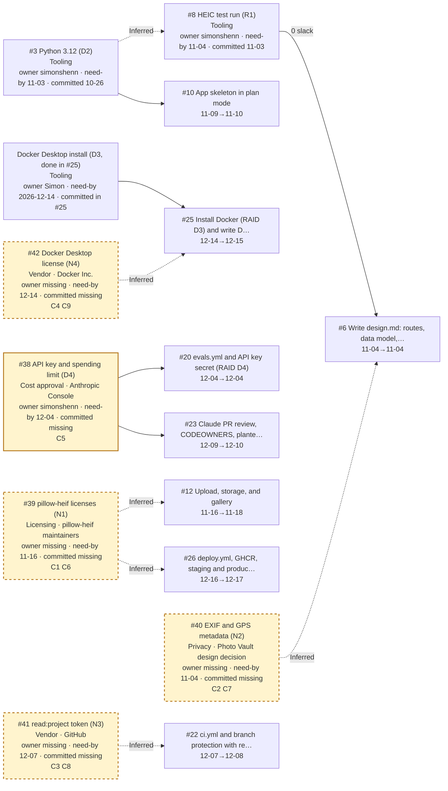

<!-- END GENERATED -->
